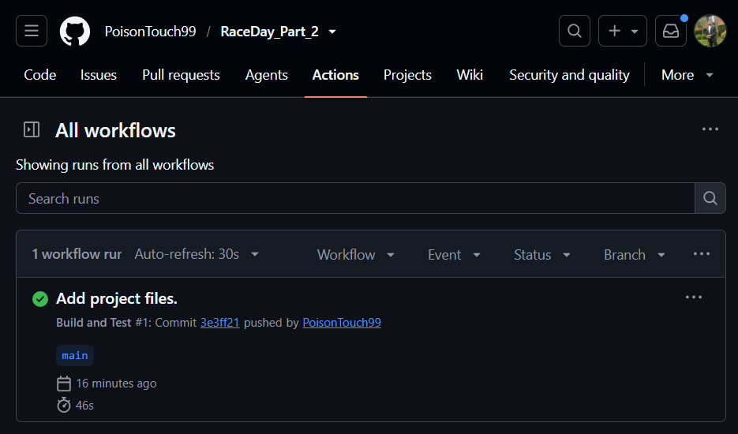

# RaceDay

RaceDay is a system for planning and running race-day events — road races, fun walks and cycle races. **Organisers** create events, define age and distance categories, and capture results afterwards. **Participants** browse published events, enter by selecting a category, and view their own results.

This repository contains **Part 1** (planning and database design, in `/docs`) and **Part 2** (the ASP.NET Core Web API, in `/src` and `/tests`).

## Role and Capabilities

**Organiser** - Create, update and delete their own events (name, description, date, location, distance, type). Define age categories (Under 20, Senior) and distance categories (10km, 21km) for those events. View all enrolments for their events. Capture and correct finish times and finishing positions. |
**Participant** - Browse published events and their categories. Enter an event by selecting a category, receiving a bib number. View and cancel their own enrolments. View their own results and public leaderboards. |

Role is chosen at registration and drives every protected endpoint. An Organiser cannot enrol; a Participant cannot manage events. Organisers are further restricted to **their own** events — attempting to modify another Organiser's event returns 403.

---


## Sample logins

Here are all the login accounts that a user can use to test the application _(All seeded accounts use the password **`Passw0rd!`**)_

| Email | Role |
|---|---|
| sarah.nkosi@raceday.co.za | Organiser |
| david.botha@raceday.co.za | Organiser |
| thabo.mokoena@example.com | Participant |
| emma.vanwyk@example.com | Participant |

## Swagger
* I have added a code that will automatically take a user straight to the website when they run the application
## Testing the API through Swagger

Authentication is **session based**, so there is no token to paste:

1. Call `POST /api/auth/login` with one of the accounts above.
2. The browser stores the session cookie automatically.
3. Every subsequent call from that Swagger page is authenticated as that user.
4. Call `POST /api/auth/logout` to clear the session, or log in as a different user to switch roles.

To see role enforcement: log in as a Participant and call `POST /api/events` — it returns **403**. Log out entirely and call it again — it returns **401**.

## Running the tests

```bash
dotnet test
```

The suite covers registration and login (including password hashing and duplicate emails), role enforcement for both roles in both directions, event management with ownership checks, enrolment recording with duplicate and capacity conflicts, and result capture with leaderboard ranking. Tests use the EF Core InMemory provider and a fake `ISession`, so no database or running server is required.


## Security notes

- Passwords are hashed with **PBKDF2-SHA256**, 100,000 iterations, with a random 128-bit salt per password. Plain-text passwords are never stored or logged.
- Password verification uses a constant-time comparison to avoid timing attacks.
- Login returns the same message for an unknown email and a wrong password, so the API does not reveal which accounts exist.
- The session cookie is `HttpOnly`, so it cannot be read by JavaScript.

## Database

Six entities: `Users`, `Events`, `Categories`, `Enrolments`, `Results`, `Payments`. The EF Core model in `RaceDayDbContext.cs` matches `docs/RaceDay_ERD.png` and `docs/RaceDay_Schema.sql` exactly.

`Enrolments` is the junction table resolving the many-to-many between Participants and Categories, carrying its own attributes (bib number, date, status) and a unique constraint on `(ParticipantId, CategoryId)`. `Results` and `Payments` hang off it one-to-one, because both are written later in the lifecycle than the enrolment itself.

Changes made to the original Part 1 design — and why — are documented in the deviations table at the end of `docs/API_Endpoint_Plan.md`.

## CI/CD

`.github/workflows/build-and-test.yml` runs on every push and pull request. It restores, builds in Release, runs the full test suite, uploads the test results, and separately validates that the required `/docs` files are present.

**Build screenshot:**



## Video walkthrough

**YouTube (unlisted):** _[Insert your unlisted YouTube link here]_

Covers the running API, the code structure, the endpoints, session authentication and role enforcement, Swagger, and the unit tests.
